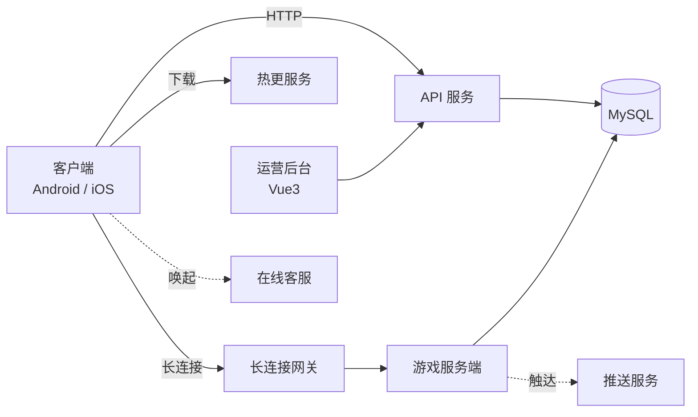
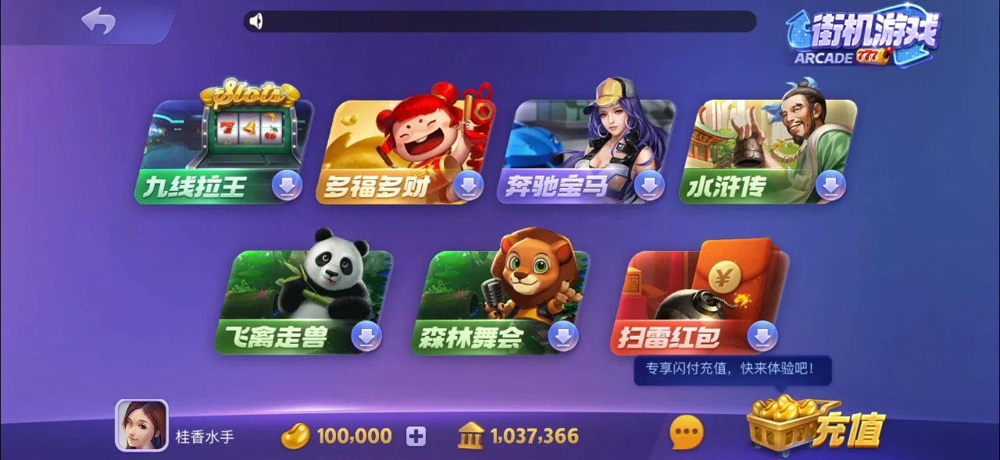
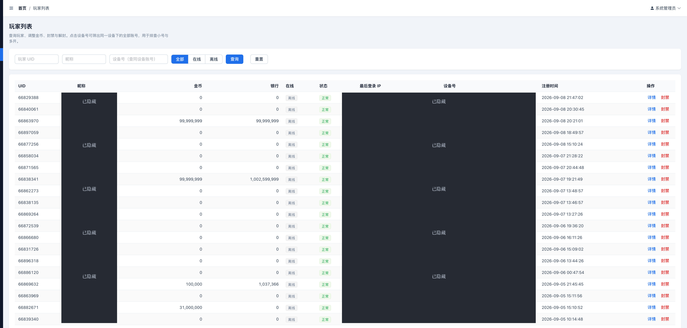

<!--
============================================================
仓库标题 / 仓库名 3 个候选（发布时二选一，改这一行的 H1，仓库名在 GitHub 建库时填）：
  1. 728-CardGame-Complete-Solution   —— 728 棋牌游戏 · 完整解决方案
  2. 728-Poker-Slots-Fishing-Solution —— 728 棋牌电玩 · 全套源码 / 26 款游戏 / 已上线交付
  3. 728-Board-Card-Game-Full-Solution—— 728 Complete Card & Slot Game Solution
本文所有内容均为脱敏展示，不含任何真实服务器地址、密钥、证书、包名与账号。
============================================================
-->

# 一言棋牌 · 728 · 63 · 850 — 棋牌电玩游戏完整解决方案

**已上线品牌**：一言棋牌 / 728 / 63 / 850（棋牌 · 电玩 · 捕鱼）　|　**语言**：简体中文

[](#技术架构)
[](#技术架构)
[](#技术架构)
[](#交付内容)
[](#交付内容)
[](#游戏内容26-款)
[](#项目简介)

> 一套**已上线运营、26 款游戏全部真机验收通过**的棋牌电玩游戏系统 —— 让你**快速拥有并运营一款属于自己的游戏产品**。
> 独立品牌、独立服务器、**完整源码一次性交付**；从部署上线到日常运营，一站式搞定。

---

## 项目简介

这是一套**完整、成体系、已上线运营**的棋牌电玩游戏解决方案（已支撑 **一言棋牌 / 728 / 63 / 850** 等多套上线品牌），面向**想快速拥有并运营一款自有游戏产品**的运营方，涵盖捕鱼、百人、棋牌、电玩四大品类共 **26 款游戏**。

系统由五部分构成，彼此解耦、可独立部署：

- **游戏服务端** —— PHP + WorkerMan 长连接网关，承载实时对战、下注、结算、断线重连。
- **管理后台** —— Vue3 + Element Plus 全新前端，运营、风控、报表一站式管理。
- **客户端** —— Cocos Creator 2.4.5 工程源码，安卓 / iOS 双端上线。
- **热更系统** —— 大厅 + 26 款游戏全量热更资源，不重新上架即可修复与迭代。
- **配套系统** —— 客服（在线聊天）、消息推送、部署运维脚本一应俱全。

> **说明**：本系统已在生产环境部署上线，26 款游戏均通过真机验收。本页展示用于说明系统能力与交付范围，实际交付内容以双方约定为准；请在采用前自行验收与合规评估。展示内容不含任何真实服务器地址、密钥、证书与账号。

---

## 核心特性

| 维度 | 能力 |
|---|---|
| **游戏体量** | 26 款游戏，覆盖捕鱼 / 百人 / 棋牌 / 电玩四大品类，全部真机验收通过 |
| **实时对战** | 长连接网关承载多人牌桌，实时下注、结算、聊天、断线重连 |
| **完整源码交付** | 客户端（Cocos 2.4.5）+ 服务端（PHP+WorkerMan）+ 后台（Vue3）全套源码，**一次性交付、完全归你、无黑盒** |
| **自有品牌** | 独立 App 名 / 图标 / 包名 / 域名 / 服务器，上线的就是**你自己的产品** |
| **双端覆盖** | 安卓 32/64 位双架构 + iOS，均已跑通真机上线 |
| **热更迭代** | 大厅与每款游戏独立热更，修 bug、上新不必重新上架应用商店 |
| **运营后台** | Vue3 全新后台：玩家 / 代理 / 充值兑换 / 报表 / 风控 / 客服，一站式管理 |
| **客服接入** | 内置在线客服与消息系统，游戏内一键唤起 |
| **成熟稳定** | 已上线运营、真机验收，不是半成品；配套标准化部署，稳定上线 |
| **省心可托** | 每个模块附操作文档；后续更新、扩展、技术支持均可对接 |

---

## 游戏内容·26 款

四大品类，全部真机验收通过（分类与命名对应客户端实际界面，见下方截图）：

### 🎣 捕鱼游戏

大闹天宫 · 大闹天宫 2 · 千炮捕鱼 3D · 捕鱼大亨

### 🃏 棋牌游戏

德州扑克 · 炸金花（赢三张）· 抢庄牛牛 · 通比牛牛 · 二人牛牛 · 四人牛牛 · 欢乐五张 · 麻将合集（温州麻将 / 二人雀神 等）

### 👥 多人对战

龙虎斗 · 百人牛牛 · 欢乐至尊（百家乐）· 欢乐 30 秒 · 十点半

### 🕹️ 街机电玩

九线拉王 · 多福多财 · 奔驰宝马 · 水浒传 · 飞禽走兽 · 森林舞会 · 红包扫雷

---

## 技术架构

| 层 | 组件 | 技术 | 职责 |
|---|---|---|---|
| 客户端 | Client | Cocos Creator 2.4.5 | 大厅、26 款游戏、安卓/iOS 双端 |
| 接入 | 长连接网关 | WorkerMan (PHP) | 实时消息、牌桌同步、断线重连 |
| 逻辑 | 游戏服务端 | PHP + WorkerMan | 对战、下注、结算、风控 |
| 接口 | API 服务 | PHP | 登录、账号、充值兑换、配置下发 |
| 数据 | 数据库 | MySQL | 玩家、账变、对局、报表 |
| 管理 | 运营后台 | Vue3 + Element Plus + Vite | 运营、风控、报表、玩家管理 |
| 资源 | 热更服务 | 静态资源分发 | 大厅 + 26 游戏全量热更 |
| 配套 | 客服 / 推送 | 在线客服 + 推送服务 | 玩家沟通、消息触达 |

**整体数据流：**



---

## 系统组成

交付为一套解耦、可独立部署的完整系统（以下为逻辑结构，真实部署参数以交付文档为准）：

```text
728-Complete-Solution/
├─ 游戏服务端      PHP + WorkerMan · 实时对战 / 下注 / 结算
├─ 接口服务        PHP · 登录 / 账号 / 兑换 / 配置下发
├─ 数据库          MySQL · 玩家 / 账变 / 对局 / 报表
├─ 客户端源码      Cocos Creator 2.4.5 工程
├─ 安卓构建        一键出包 · 换包名 / App 名 / 图标 / 证书
├─ iOS 构建        Xcode 一键出包脚本
├─ 运营后台        Vue3 + Element Plus + Vite
├─ 热更资源        大厅 + 26 款游戏全量
├─ 推送服务        游戏内消息触达
├─ 客服系统        在线聊天 / 消息（游戏内唤起）
└─ 部署运维        标准化搭建脚本 + 迁移校验
```

---

## 产品截图

> 以下为其中一套已上线换皮版本的真实界面（该版本客户端品牌为「一言棋牌」，728 系统支持任意换皮）。

**大厅主界面**


| 登录页 | 捕鱼游戏 |
|---|---|
|  |  |

| 棋牌游戏 | 多人对战 |
|---|---|
|  |  |

**街机电玩**



**运营后台（玩家管理）**



> 后台为真实运营界面；玩家昵称 / IP / 设备号等隐私字段已打码处理。

---

## 交付内容

一次性交付、**完全归你**的一整套可运营产品（源码 + 部署 + 文档，无黑盒依赖）：

- ✅ **客户端源码**：Cocos Creator 2.4.5 完整工程，可改功能、换 UI、自由扩展。
- ✅ **服务端与接口源码**：PHP + WorkerMan，实时对战与业务接口齐全。
- ✅ **数据库结构与初始数据**：开箱即用。
- ✅ **安卓 / iOS 双端**：均已真机上线，可一键换成你的品牌。
- ✅ **全套热更资源**：大厅 + 26 款游戏，支持不上架迭代。
- ✅ **运营后台**：Vue3 全新前端 + 接口，源码交付。
- ✅ **客服 / 推送 / 部署运维**：配套系统与标准化搭建脚本。
- ✅ **操作文档**：每个模块附「怎么用」说明，随时可查。

---

## 从交付到上线，你专注运营

- **快速上线** —— 系统已成熟跑通，无需从零开发；完成部署与你的品牌配置后即可对外运营。
- **完全自主** —— 独立服务器、独立域名、独立 App 名 / 图标 / 品牌，上线的就是**你自己的产品**，数据与运营尽在自己手中。
- **一站式交付** —— 完整源码 + 部署 + 使用文档一并交付，不留黑盒；后续更新、扩展、技术支持均可对接。
- **省心运营** —— 全套运营后台（玩家 / 代理 / 充值兑换 / 报表 / 风控 / 客服）开箱即用，你只管把量做起来。

---

## 合规与授权声明

- 本项目为**软件技术解决方案展示**，仅供技术交流与合法商业用途评估。
- 采用方须自行确保在其运营地区**符合当地法律法规**，包括但不限于经营资质、支付合规、数据隐私、未成年人保护等，并自负相应责任。
- 本仓库为**展示与交流用途**，不含完整源码与任何真实凭据；完整授权与交付以双方书面约定为准。
- 请勿将本系统用于任何违反当地法律的用途。

---

## 联系与购买

| 渠道 | 地址 |
|---|---|
| **Telegram** | [@root4433](https://t.me/root4433) |
| **Email** | uaredan0925@gmail.com |

演示、报价、定制与交付细节，欢迎通过以上渠道私聊。

---

如果这个项目对你有帮助，欢迎点一个 ⭐ Star 支持一下。
